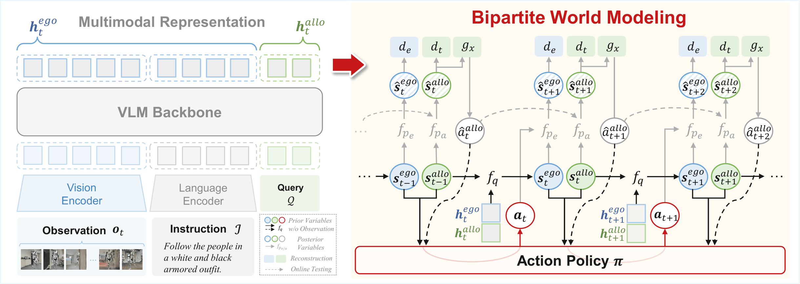

# **Bipartite World Modeling: Unifying Egocentric and Allocentric Dynamics for Embodied Target Tracking**

**Xuan Yao, Jiahao Zhang, Junyu Gao, Yong Rui and Changsheng Xu**

> World models provide a principled framework for modeling latent dynamics in embodied agents. However, existing approaches typically rely on a unified latent representation that assumes single temporal transition, which may be insufficient for target-centric embodied settings where heterogeneous dynamics coexist. In such scenarios, agent motion induces rapid global scene changes, while task-relevant entities require temporally consistent representations over time.
We propose a bipartite world modeling framework that structures the latent state into an egocentric component modeling scene evolution and an allocentric component maintaining temporally coherent target representation. These two states are jointly inferred and evolve through differentiated transition mechanisms within a unified world model.
We evaluate our approach on embodied target tracking benchmarks, a representative setting where such heterogeneous dynamics are prominent. Experiments on three benchmarks demonstrate state-of-the-art performance, along with effective real-world deployment on a quadruped robot. 




## :loudspeaker: News!

- **[2026/10/25]** We released our training codes! Everyone is welcome to use it! 🎉
- **[2026/10/25]** We released the original Bipartite World Modeling checkpoint for EVT-Bench on [Hugging Face](https://huggingface.co/JahaoZhang/Bipartite-World-Modeling). 🎉
- **[2026/08/28]** Our paper has been selected for an **Oral Presentation** at ACM Multimedia 2026! 🎉
  - 🎤 **Oral:** November 11, 2026, 14:54–15:12 | Oceania IV–V
  - 📌 **Poster:** November 11, 2026, 16:00–18:00 | Versailles
- **[2026/07/10]** Our paper has been accepted to ACM Multimedia 2026. 🎉

---
## :rocket: Quick Start

### 1. Environment Setup

#### 1.1 Create Conda Environment

```bash
conda create -n BWM python=3.9 cmake=3.14.0
conda activate BWM
```

---

#### 1.2 Install PyTorch

```bash
pip install torch==2.8.0+cu128 torchvision==0.23.0+cu128 torchaudio==2.8.0+cu128 \
  --index-url https://download.pytorch.org/whl/cu128
```

---

#### 1.3 Install Project Dependencies

All required Python packages are specified in `pyproject.toml`. Install via:

```bash
pip install -e .
```

---

#### 1.4 Install Habitat

Follow the [Habitat Installation Guide](https://github.com/facebookresearch/habitat-lab#installation) and [OpenTrackVLA](https://github.com/om-ai-lab/OpenTrackVLA) to install [`habitat-lab`](https://github.com/facebookresearch/habitat-lab) and [`habitat-sim`](https://github.com/facebookresearch/habitat-sim)

We use **Habitat v0.3.1** in all experiments.

```bash
conda install habitat-sim==0.3.1 withbullet headless -c conda-forge -c aihabitat
pip install -e habitat-lab
```

---

<br/>

## :pencil: Data Preparation

### 2. Dataset Preparation

#### 2.1 Simulator Assets (HM3D & MP3D)

The simulator assets and humanoid avatars follow **exactly** the instructions from the original **TrackVLA** release.
Please **accept the corresponding licenses** before downloading.

* Request access via Habitat:

  * [HM3D](https://github.com/facebookresearch/habitat-sim/blob/main/DATASETS.md#habitat-matterport-3d-research-dataset-hm3d)
  * [MP3D](https://github.com/facebookresearch/habitat-sim/blob/main/DATASETS.md#matterport3d-mp3d-dataset)

* After approval, download and extract the datasets under `data/scene_datasets` so that the final directory structure is:

```text
data/
  scene_datasets/
    hm3d/
      train/...
      val/...
      minival/...
    mp3d/
      1LXtFkjw3qL/...
      ...
```

* If the datasets are staged elsewhere first, move them using:

```bash
mv /path/to/hm3d data/scene_datasets/
mv /path/to/mp3d data/scene_datasets/
```

 **Important**: Directory names must remain lowercase (`hm3d`, `mp3d`) to ensure Habitat config files resolve correctly.

---

#### 2.2 Humanoid Avatars

From the repository root, run:

```bash
python download_humanoid_data.py
```

This script mirrors the original TrackVLA helper and should populate:

```text
data/humanoids/
```

If the script fails (e.g., Google Drive quota issues):

1. Manually download `humanoids.zip` from:
   [Google Drive](https://drive.google.com/file/d/1aE_wyvPqvOuVmF8px2vTO3trr70DKf1l/view)

2. Extract it with:

```bash
unzip humanoids.zip -d data/
```

Ensure that `data/humanoids/**` contains the required FBX meshes for Habitat.

---

<br/>

## ⚓ VLM backbone <a name="vlm"></a>
We use the `Prismatic-VLMs` architecture. Since the file is large, please download it from [here](https://huggingface.co/Stanford-ILIAD/prism-qwen25-extra-dinosiglip-224px-0_5b). Then put it in the `/pretrained_models` folder. The file structure is:

```
·
├── pretrained_models
·   ├── configs
    └── prism-qwen25-extra-dinosiglip-224px-0_5b
```

<br/>

## :fire: Training

Fine-tune **BWM** on a single **NVIDIA GeForce RTX 5090 (32 GB)**. The command loads the Prismatic VLM from the previous section, updates it with LoRA (`rank 32`), and trains the Pro policy head (`--use_pro_version True`). The per-GPU batch size is 8. With `--grad_accumulation_steps 2`, the effective batch size on this one GPU is 16.

Set these before launching:

- `data_name` and `--data_root_dir`: the RLDS dataset name and the directory that contains it. Names already registered in this repo include `hm3dpath_dataset`.
- `--wandb_entity`: your Weights & Biases entity. Log in once with `wandb login`. Training curves are written to the project given by `$data_name`.

Each step feeds `--num_images_in_input 28` RGB frames. Proprioception and FiLM stay off (`--use_proprio False`, `--use_film False`), and image augmentation stays on. The learning rate starts at `2e-4` and is multiplied by `0.1` at step 25,000. Training stops at step 25,005. A checkpoint is saved every 500 steps under `/outputs`, with LoRA weights merged into each checkpoint. The job runs in the background, and its log is written to `logs/`.

```bash
mkdir -p logs
data_name=your_dataset
CUDA_VISIBLE_DEVICES=0 torchrun --standalone --nnodes 1 --nproc-per-node 1 vla-scripts/finetune.py \
  --vlm_path pretrained_models/prism-qwen25-extra-dinosiglip-224px-0_5b \
  --config_file_path pretrained_models/configs \
  --data_root_dir /root_dir/of/your_dataset \
  --dataset_name $data_name \
  --run_root_dir /outputs \
  --use_film False \
  --num_images_in_input 28 \
  --use_proprio False \
  --use_lora True \
  --use_fz False \
  --use_minivlm True \
  --image_aug True \
  --num_steps_before_decay 25000 \
  --max_steps 25005 \
  --save_freq 500 \
  --save_latest_checkpoint_only False \
  --merge_lora_during_training True \
  --batch_size 8 \
  --grad_accumulation_steps 2 \
  --learning_rate 2e-4 \
  --lora_rank 32 \
  --use_pro_version True \
  --wandb_entity "YOUR_WANDB_ENTITY" \
  --wandb_project "$data_name" \
  --run_id_note BWM--$data_name--$current_time \
  > logs/BWM--$data_name--$current_time.log 2>&1 &
```

<br/>

## :mechanical_arm: Online Evaluation

Download the released checkpoint from [Hugging Face](https://huggingface.co/JahaoZhang/Bipartite-World-Modeling) and place it in the `model/` folder at the repository root. Evaluation loads weights from this folder.

```bash
hf download JahaoZhang/Bipartite-World-Modeling --local-dir model
```

Evaluate **BWM** on **EVT-Bench** by running:

```bash
bash eval_bwm_agent.sh
```

Monitor evaluation results in real time using:

```bash
watch -n 1 python analyze_results.py --path /path/to/exp_results_folder
```

---

<br/>

## 📝 Citation <a name="cite"></a>

### 🫶 If you feel that this paper, models, or codes are helpful, please cite our paper, thanks for your support of Bipartite World Modeling!

```bibtex

```

## :heart: Acknowledgment

We thank [VLA-Adapter](https://github.com/OpenHelix-Team/VLA-Adapter), [OpenVLA-OFT](https://github.com/moojink/openvla-oft), [MiniVLA](https://github.com/Stanford-ILIAD/openvla-mini), and [RoboDual](https://github.com/OpenDriveLab/RoboDual) for their open-sourced work!

---
